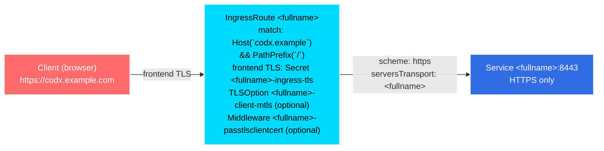

# Ingress exposure (Traefik IngressRoute)

This document describes how the chart exposes the CodX server at the edge:
the Traefik IngressRoute it creates, the frontend TLS options (including
the cert-manager certificate), and the backend TLS to the CodX service.

The chart does not create a standard Kubernetes Ingress: CodX is exposed
through a Traefik IngressRoute, which requires the Traefik Kubernetes CRD
provider (IngressRoute, Middleware, TLSOption). With another ingress
controller, set `ingress.enabled=false` and create your own objects (see
[Using your own ingress objects](#using-your-own-ingress-objects)).

## Overview



The backend Service only exposes the HTTPS port (`containerPorts.https`,
default 8443): the CodX server serves HTTPS and nothing else (TLS is
mandatory in the server). Traefik therefore dials the backend with
`scheme: https` and the chart ServersTransport, which trusts the
chart-internal CA.

## Created objects

| Object | Name | Created when |
|--------|------|--------------|
| IngressRoute | `<fullname>` | `ingress.enabled` (default) |
| ServersTransport | `<fullname>` | `tls.enabled` (default) |
| Certificate (cert-manager) | `<fullname>-ingress` | `ingress.certManager.enabled` |
| TLS Secret (issued by cert-manager) | `<fullname>-ingress-tls` | by cert-manager, from the Certificate above |

All objects are created in the release namespace.

## Hosts and routes

One route rule is generated per host:

- `ingress.hostname` with `ingress.path` (default `/`),
- every entry of `ingress.extraHosts` (`name`, `path` defaulting to `/`).

Each rule matches `Host(`<name>`) && PathPrefix(`<path>`)` and targets the
`<fullname>` Service on the HTTPS port. When `ingress.hostname` is empty,
only the `extraHosts` routes are generated.

The IngressRoute carries `ingress.annotations` (merged with
`commonAnnotations`) and the standard chart labels plus `commonLabels`.
Traefik entryPoints are selected with `ingress.entryPoints` (e.g.
`websecure`); when empty, the route binds to all entry points.

## Middlewares

Middlewares are attached to every route, in order:

1. the ones from `ingress.middlewares` (each entry is `name` + optional
   `namespace`; a namespace defaults to the release namespace, and
   cross-namespace references require the Traefik `allowCrossNamespace`
   option),
2. the chart `passTLSClientCert` Middleware when `traefikMtls.enabled`.

The mTLS middleware, its TLSOption and the client CA Secret are documented
in [Authentication](authentication.md).

## Frontend TLS

The `tls` block of the IngressRoute is rendered when `ingress.tls.enabled`
is true or when `ingress.certManager.enabled` is true (the cert-manager
certificate implies the frontend TLS - without it, the issued Secret would
never be served).

| Key | Role |
|-----|------|
| `ingress.tls.secretName` | Secret holding the certificate Traefik presents to the clients. Defaults to `<fullname>-ingress-tls` when `ingress.certManager.enabled` (see below); when empty and no certificate is requested, no `secretName` is set on the route. |
| `ingress.tls.certResolver` | Alternative to `secretName`: Traefik ACME resolver (e.g. `letsencrypt`) issuing the certificate on the fly. |
| `ingress.tls.options.name` / `.namespace` | TLSOption applied to the route (e.g. to request client certificates). Defaults to the chart client-mTLS TLSOption when `traefikMtls.enabled` and nothing is set. |

The route also carries the TLS domains, so Traefik answers for every host:
`main` is the first host (`ingress.hostname` or the first `extraHosts`
entry), the other hosts are listed as `sans`.

### cert-manager certificate (`ingress.certManager`)

Instead of an existing Secret or a Traefik ACME resolver, the chart can
request the certificate from cert-manager. With
`ingress.certManager.enabled=true` the chart creates:

| Property | Value |
|----------|-------|
| Certificate name | `<fullname>-ingress` |
| Secret | `ingress.tls.secretName` or `<fullname>-ingress-tls` |
| commonName | `ingress.hostname` |
| dnsNames | `ingress.hostname` and every `ingress.extraHosts` name |
| usages | `server auth` |
| issuerRef | `ingress.certManager.issuerRef` (`name` required, `kind` default `ClusterIssuer`, `group` default `cert-manager.io`) |
| labels / annotations | standard chart labels plus `commonLabels` and `ingress.certManager.labels`; `ingress.certManager.annotations` merged with `commonAnnotations` |

Example:

```yaml
ingress:
  hostname: codx.example.com
  extraHosts:
    - name: www.codx.example.com
  tls:
    enabled: true
  certManager:
    enabled: true
    issuerRef:
      name: letsencrypt
      kind: ClusterIssuer
```

Notes:

- `ingress.hostname` and `ingress.certManager.issuerRef.name` are required
  when the certificate is enabled: `helm template` fails with an explicit
  error message otherwise.
- An explicit `ingress.tls.secretName` wins over the
  `<fullname>-ingress-tls` default for both the Certificate and the
  IngressRoute.
- The ingress certificate is independent from the chart internal TLS
  (`tls.enabled`), which covers the CodX *service* certificate - not the
  public hostname.
- The Certificate requires cert-manager to be installed in the cluster.

## Backend TLS (ServersTransport)

The CodX server presents the certificate issued by the chart internal CA
(`<fullname>-server-tls`). For Traefik to trust it when dialing
`https://<fullname>:8443`, the chart creates the ServersTransport
`<fullname>` whenever `tls.enabled` is true:

- `rootCAs`: the `ca.crt` of the `<fullname>-server-tls` Secret,
- `serverName`: the Service FQDN `<fullname>.<namespace>.svc.<clusterDomain>`,
  matching the certificate DNS names.

Since the server speaks HTTPS only, keep `tls.enabled` (the default) when
using the chart IngressRoute: with it disabled the route dials the backend
as plain HTTP and the connection fails.

## Traefik v2 and v3

The CRD API version differs between Traefik major versions:

| Traefik | Setting | Value |
|---------|---------|-------|
| v3 (default) | `ingress.apiVersion` and `traefikMtls.apiVersion` | `traefik.io/v1alpha1` |
| v2 | `ingress.apiVersion` and `traefikMtls.apiVersion` | `traefik.containo.us/v1alpha1` |

## Using your own ingress objects

Set `ingress.enabled=false` to skip the IngressRoute and expose CodX with
your own objects (e.g. a standard Ingress for another controller, or an
IngressRoute you manage). Requirements to keep in mind:

- route to the Service `<fullname>` on the HTTPS port `containerPorts.https`
  (8443) over HTTPS, trusting the chart CA (or replicate the ServersTransport
  settings),
- allow the ingress controller traffic in the NetworkPolicy
  (`networkPolicy.codx.ingress.fromIngressController`, enabled by default),
- the mTLS fallback objects (`traefikMtls`) still need to be wired to your
  route by hand: the chart only attaches them to its own IngressRoute.

## Troubleshooting

| Symptom | Likely cause and check |
|---------|------------------------|
| 404 on the hostname | Route/host mismatch: check the rendered match rules (`helm template`, look for `Host(\`...\`)`), the `ingress.entryPoints` list and that Traefik serves that entry point. |
| Traefik serves the wrong / default certificate | No `secretName` on the route: enable `ingress.tls.enabled` or `ingress.certManager.enabled`, or check the Secret exists in the release namespace. |
| Certificate stays `Not Ready` | cert-manager cannot issue: `kubectl describe certificate <fullname>-ingress` (issuerRef name/kind, ACME challenge of the `issuerRef` issuer). |
| 502 / connection reset to the backend | Backend dial failure: keep `tls.enabled=true` (the server only speaks HTTPS) and check the ServersTransport `<fullname>` exists; check the NetworkPolicy allows the ingress controller. |
| Client certificates ignored | The client-mTLS TLSOption is not applied: it requires the frontend TLS and defaults to the chart TLSOption only when `traefikMtls.enabled` - see [Authentication](authentication.md). |
| CRDs rejected by the API server | Wrong CRD API version for your Traefik: set `ingress.apiVersion` (and `traefikMtls.apiVersion`) to `traefik.containo.us/v1alpha1` on Traefik v2. |

## Related documents

- [Authentication](authentication.md) - the mTLS fallback objects
  (TLSOption, passTLSClientCert Middleware, client CA Secret).
- [Workspace creation](workspace-creation.md) - the full TLS model, from
  the browser to the workspace.
- [Documentation index](README.md)
